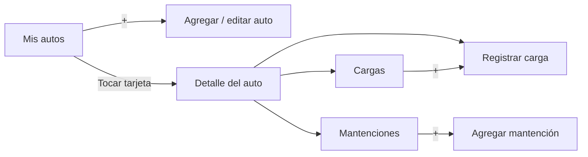

# AutoControl

Aplicación Android para registrar las cargas de combustible, calcular el rendimiento real (km/l) y controlar las mantenciones de uno o más autos.

## Problema

Muchas personas que tienen auto olvidan a qué kilometraje les corresponde una mantención (cambio de aceite, rotación de neumáticos, revisión de frenos) y no saben cuánto rinde realmente su vehículo. Esto provoca fallas mecánicas evitables, gastos mayores y pérdida de control sobre el costo de uso del auto.

### Causas identificadas
- Las mantenciones dependen del kilometraje, un dato que el conductor no suele revisar ni anotar.
- No existe un registro ordenado de las cargas de combustible, por lo que el rendimiento real no se conoce.
- Calcular el rendimiento a mano requiere anotar el odómetro y los litros en cada carga, algo que casi nadie hace.

## Solución

AutoControl permite llevar un registro simple de cada auto: con cada carga de combustible calcula automáticamente el rendimiento y el costo por kilómetro, y compara el odómetro con las mantenciones registradas para avisar cuáles están próximas o atrasadas.

## Funcionalidades

**Autos**
- Agregar, editar y eliminar autos (nombre, patente y kilometraje inicial).
- Vista en grilla de todos los autos registrados.

**Cargas de combustible**
- Registro de odómetro, litros y costo de cada carga.
- Cálculo automático de rendimiento (km/l) y costo por kilómetro.
- Historial de cargas ordenado de la más reciente a la más antigua. 
- Eliminar cargas con confirmación; el rendimiento se recalcula automáticamente.

**Mantenciones** (valor agregado)
- Registro de mantenciones con el kilometraje en que corresponden.
- Estado automático según el odómetro actual:
    - **Pendiente:** faltan más de 1.000 km.
    - **Próxima:** faltan 1.000 km o menos.
    - **Atrasada:** se superó el kilometraje.
    - **Completada:** marcada por el usuario.
- La próxima mantención pendiente se muestra en el detalle del auto.

**Estabilidad y validaciones**
- Validación de todos los formularios (campos vacíos, valores en cero o negativos, odómetro menor al último registro, litros fuera de rango, patente con caracteres inválidos).
- Confirmación antes de eliminar.
- Mensajes claros cuando no hay datos.
- Manejo de errores al guardar, con registro en Logcat.
- Los datos se conservan al girar la pantalla y al cerrar la app.

## Navegación



## Tecnologías

| Herramienta | Uso |
|---|---|
| Kotlin | Lenguaje de programación |
| Android Studio | Entorno de desarrollo |
| XML + Views | Diseño de las pantallas |
| Room (SQLite) | Base de datos local |
| KSP | Generación de código de Room |
| Coroutines y Flow | Operaciones en segundo plano y actualización automática de las listas |
| Material Design 3 | Componentes visuales (tarjetas, botones, campos de texto, diálogos) |

- **Versión mínima de Android:** 8.0 (API 26)
- **Sin inicio de sesión:** los datos se guardan solo en el dispositivo.

## Estructura del proyecto

```
com.proyecto.autocontrol
 ├── data/
 │    ├── Auto.kt, Carga.kt, Mantencion.kt        → Entidades (tablas)
 │    ├── AutoDao.kt, CargaDao.kt, MantencionDao.kt → Operaciones CRUD
 │    └── AppDatabase.kt                           → Base de datos Room
 ├── MainActivity.kt              → Mis autos
 ├── AutoFormActivity.kt          → Agregar / editar auto
 ├── DetalleAutoActivity.kt       → Resumen del auto
 ├── CargaFormActivity.kt         → Registrar carga
 ├── CargasActivity.kt            → Historial de cargas
 ├── MantencionesActivity.kt      → Lista de mantenciones
 ├── MantencionFormActivity.kt    → Agregar mantención
 ├── AutoAdapter.kt, CargaAdapter.kt, MantencionAdapter.kt → Listas
 ├── Calculos.kt                  → Rendimiento, costo por km y estados
 └── Formatos.kt                  → Números, pesos y fechas en formato chileno
```

## Cálculos

- **Rendimiento (km/l)** = (odómetro actual − odómetro anterior) ÷ litros cargados
- **Costo por km** = costo de la carga ÷ km recorridos
- Para la primera carga, el odómetro anterior es el kilometraje inicial del auto.
- Se asume que cada carga es con estanque lleno, que es el método habitual para medir el rendimiento real.

## Cómo ejecutar

1. Clonar el repositorio:
   ```bash
   git clone https://github.com/CinthyMartine/AutoControl.git
   ```
2. Abrir la carpeta en Android Studio y esperar la sincronización de Gradle.
3. Ejecutar en un emulador o dispositivo con Android 8.0 o superior.

La app se instala sin datos: todo se agrega desde la propia aplicación.

## Pruebas realizadas

| # | Prueba | Resultado |
|---|---|----|
| 1 | Abrir la app recién instalada muestra el mensaje de lista vacía | OK |
| 2 | Guardar auto con campos vacíos muestra errores | OK |
| 3 | Patente con caracteres inválidos muestra error | OK |
| 4 | Agregar auto válido lo muestra en la lista | OK |
| 5 | Volver desde el formulario no guarda datos | OK |
| 6 | Nombre largo se corta sin romper la tarjeta | OK |
| 7 | Varios autos se muestran en grilla de 2 columnas | OK |
| 8 | Editar auto carga y guarda los cambios | OK |
| 9 | Auto sin cargas muestra "—" en el rendimiento | OK |
| 10 | Guardar carga con campos vacíos muestra errores | OK |
| 11 | Odómetro menor o igual al último muestra error | OK |
| 12 | Litros en 0 o mayores a 200 muestran error | OK |
| 13 | Litros con coma decimal se aceptan | OK |
| 14 | Carga válida calcula el rendimiento correcto | OK |
| 15 | Historial ordenado con km/l y costo por km correctos | OK |
| 16 | Auto sin cargas muestra mensaje en el historial | OK |
| 17 | Mantención vacía o con km 0 muestra errores | OK |
| 18 | Estados y colores de mantenciones correctos | OK |
| 19 | Marcar mantención como completada y como pendiente | OK |
| 20 | El detalle muestra la próxima mantención pendiente | OK |
| 21 | Eliminar mantención con confirmación | OK |
| 22 | Eliminar auto borra también sus cargas y mantenciones | OK |
| 23 | Girar la pantalla no pierde datos ni cierra la app | OK |
| 24 | Tocar Guardar varias veces guarda una sola vez | OK |
| 25 | Los datos se conservan al cerrar y abrir la app | OK |
| 26 | Editar el km inicial no provoca cierres | OK |
| 27 | Eliminar una carga recalcula el rendimiento y permite corregir un odómetro mal ingresado | OK |

## Contexto académico

Proyecto desarrollado para la asignatura **Taller de aplicaciones móviles** (AIEP), Unidad 2: Diseño de aplicaciones móviles (Android). Actividad sumativa, semana 7.

**Integrantes:** Cinthya Martínez, Gerardo Crisóstomo y Paula Andrade.
